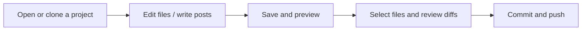

<div align="center">

# Cuttle

[简体中文](README.md) · **English**

**A local desktop workspace, from writing to committing.**

Open projects, edit files, preview posts, and manage Git in one place.

[](https://github.com/egoist/mygo)
[](https://go.dev/)
[](https://react.dev/)
[](https://www.typescriptlang.org/)

[Features](#features) · [Quick start](#quick-start) · [Usage](#usage) · [Development and builds](#development-and-builds)

</div>

---

## Why Cuttle?

Cuttle is a local desktop tool built with [MyGo](https://github.com/egoist/mygo) for personal blogs, Markdown documentation, and Git projects.

Choose a folder to get started. Manage files in ordinary directories, work with branches and commits in Git repositories, and get bilingual post editing and site previews for Jekyll blogs.

- **Local projects**: use your own folders, Git configuration, and SSH keys.
- **Multiple workspaces**: switch between projects or clone another repository.
- **A complete writing workflow**: edit, recover drafts, preview posts, review changes, commit, and push.

## Features

| Feature            | Capabilities                                                                                                 |
| ------------------ | ------------------------------------------------------------------------------------------------------------ |
| Projects           | Open local folders, switch recent projects, clone SSH / HTTPS / local repositories                           |
| Files              | Create, copy, rename, move, import, replace, and move files or directories to Trash; drag items into folders |
| Editing and search | Multiple tabs, syntax highlighting for common languages, filename and text search, hidden file visibility    |
| Binary files       | View images, replace files, open files in system applications                                                |
| Markdown           | Source editing, rendered previews, image insertion at the cursor, automatic local drafts                     |
| Jekyll blogs       | Create posts, edit Chinese/English titles, summaries, and body text, build previews with the blog theme      |
| Git branches       | Create and switch local branches, create remote tracking branches, stash and restore changes                 |
| Remotes            | Add, edit, or remove remotes; configure separate fetch and push URLs                                         |
| Git sync           | Fetch, fast-forward-only pull, push the current branch                                                       |
| Commit review      | Select files, review diffs, write a commit message, optionally push after committing                         |



## Quick start

### Run from source

Install these prerequisites:

| Dependency     | Requirement                                                                           |
| -------------- | ------------------------------------------------------------------------------------- |
| Go             | 1.27.3 or later; see `go.mod`                                                         |
| Node.js        | 22.12+ recommended                                                                    |
| Git            | Installed and available on the command line                                           |
| Ruby / Bundler | Only needed for Jekyll site previews; install the blog's Gemfile dependencies as well |

From the project directory:

```sh
cd Cuttle
npm ci
npm run dev
```

This starts the Vite development server and a native MyGo window. Bun is included as a development dependency and does not need a separate installation.

> Opening the Vite page in an ordinary browser does not provide access to the Go native services. Use the MyGo window to work with projects.

### Build the desktop app

```sh
npm run build
```

The default output on an Apple Silicon Mac is:

```text
build/darwin-arm64/Cuttle.app
```

Open the app and choose your project folder. macOS arm64 builds have been verified; other platforms have not been validated. The app uses a local ad hoc signature and has not been notarized with a Developer ID.

## Usage

The current application interface uses Chinese labels. Their English equivalents are included below to help you find the controls.

### Open and switch projects

Use **打开文件夹 (Open folder)** in the header to select a local directory, or **克隆 (Clone)** to enter a Git URL and destination. Switch between previously opened projects using the project selector. Up to 20 recent projects are retained.

Editing a URL in **远程仓库 (Remotes)** updates the current project's Git remote. To use a different working directory, open its folder or clone it as a new project.

### Edit files

- Open files from the tree on the left. Keep multiple files open in tabs.
- Select a directory to set the destination for new files. Right-click an item or use its `⋯` menu to create files/directories, copy, move, rename, or move it to Trash.
- Drag a file or directory onto a target folder, or onto the project-root drop area, to move it. Copying directories includes their children; existing destinations are never overwritten. Symlinks and nested Git metadata cannot be copied.
- Press `⌘S` / `Ctrl+S` to save all edits.
- Use the search panel to find filenames or text content.
- Enable **显示隐藏文件与依赖目录 (Show hidden files and dependency directories)** to browse configuration files and dependencies.

Unsaved edits are automatically stored as local drafts. Reopen the same project, branch, and file to recover them. If the disk content has changed, Cuttle shows a conflict notice and the version on disk.

### Write and preview blog posts

When Cuttle detects `_config.yml` at the project root, it enables Jekyll writing features:

1. Click **写文章 (Write a post)** and enter a title, date, and filename to create `_posts/YYYY-MM-DD-slug.md`.
2. Edit the full source, or switch to **文章表单 (Post form)** to enter Chinese / English content.
3. Click **Markdown 预览 (Markdown preview)** for rendered Markdown, or **真实博客预览 (Blog preview)** to build a page using the project's Jekyll templates.
4. Save the file when ready, then review and commit it in the Git panel.

Click **插入图片 (Insert image)** in the editor to select a PNG, JPEG, GIF, or WebP image (up to 20 MB). Cuttle saves it with a unique name under `assets/images` and inserts a Markdown reference at the cursor, in source mode or either language’s body editor. Save the article, then select both the article and image files in the Git panel. Jekyll references use `relative_url` so site base paths work in previews and published pages.

The bilingual form uses `title`, `summary`, the Markdown body, and the `title_en`, `summary_en`, and `content_en` fields. Other YAML fields are preserved. Your blog theme must support these bilingual fields; Cuttle does not modify the theme automatically.

Blog previews are built in a temporary project copy and include the current file's unsaved content. Install the blog dependencies with Bundler in the blog directory first. If `vendor/bundle` exists, the preview uses it. On macOS, Cuttle supports Homebrew Ruby 3.3 paths and can also use Bundler from the system PATH.

### Manage branches and commits

1. Select a branch in the header or create a new one. If the working tree has changes, commit them first or choose to save and stash before switching.
2. Open **提交改动 (Changes)** and select the files for this commit.
3. Click **审阅并提交 (Review and commit)** to inspect the diff, branch, and push target.
4. Enter a commit message, then choose to commit only or commit and push the current branch.

Push after commit is enabled by default. If pushing fails, the local commit is retained. Resolve the network or authentication issue and click **推送 (Push)** to retry. Stashes are not automatically restored after a branch switch; restore the latest stash from the Git panel when needed.

Git operations use your existing local identity configuration and SSH keys. Configure your Git username and email and verify authentication for the target repository before committing.

## Development and builds

| Command             | Purpose                                                              |
| ------------------- | -------------------------------------------------------------------- |
| `npm run dev`       | Start the native app and frontend development server                 |
| `npm run dev:web`   | Start only the frontend development server                           |
| `npm run generate`  | Regenerate TypeScript bindings from Go services                      |
| `npm run build:web` | Type-check TypeScript and build the frontend                         |
| `npm run build`     | Build the app for the current platform; produces an `.app` on macOS  |
| `npm run build:dmg` | Also create a macOS DMG; requires working system disk-image services |
| `npm test`          | Run file, Git, and Markdown preview tests                            |

Optionally run the Jekyll integration test. It reads the specified blog and builds a temporary copy:

```sh
STUDIO_JEKYLL_FIXTURE=/absolute/path/to/blog go test ./internal/...
```

The integration test includes a non-UTF-8 startup environment to cover encoding issues with Chinese filenames in desktop apps.

### Project structure

```text
Cuttle/
├── main.go                  # MyGo entry point and native service bindings
├── internal/workspace/
│   ├── workspace.go         # Projects, file operations, search, and drafts
│   ├── files.go             # Recursive copying and image imports
│   ├── git.go               # Branches, remotes, commits, and sync
│   ├── preview.go           # Markdown / Jekyll preview service
│   └── *_test.go            # Core behavior tests
├── src/
│   ├── main.tsx             # React mounting entry point
│   ├── app/                 # Workspace state, actions, and types
│   ├── components/          # Project entry, file tree, editor, and dialogs
│   ├── hooks/               # On-demand editor language loading
│   ├── lib/                 # YAML frontmatter parsing
│   ├── styles/              # Color tokens, base styles, layout, and components
│   ├── style.css            # Stylesheet entry point
│   └── mygo.ts              # Generated TypeScript bindings
├── scripts/mygo.mjs         # MyGo CLI wrapper
├── mygo.config.ts           # App name, identifier, and build settings
└── vite.config.ts           # Frontend development and build settings
```

The interface uses navy navigation, light workspace surfaces, and teal accents. Shared color tokens live in `src/styles/tokens.css`; layout and component styles are split into separate files. The editor loads on demand when a file is opened.

## Data and operational boundaries

- **Local storage**: recent projects and drafts default to `Cuttle` under the user's system configuration directory, typically `~/Library/Application Support/Cuttle` on macOS. Override it with `CUTTLE_DATA`.
- **Upgrade compatibility**: if the new directory does not exist and an older `GochiefStudio` or `Gochief` data directory is found, Cuttle continues using it to preserve drafts and project records. The legacy `GOCHIEF_DATA` and `GOCHIEF_STUDIO_DATA` variables are also supported.
- **File saves**: atomic replacement checks the disk revision and branch. Direct access to `.git`, paths outside the project, and symlinks pointing outside the project are rejected.
- **Recoverable deletion**: files and directories are moved to the system Trash, with no permanent-delete fallback.
- **Commit isolation**: a temporary Git index preserves the staged state of unselected files. Files and HEAD are rechecked before committing, and existing repository Git hooks are executed.
- **Sync behavior**: pulls are fast-forward only. Cuttle does not automatically resolve conflicts or force-push.
- **Preview isolation**: the preview service listens only on `127.0.0.1` and uses random-token URLs. Preview pages are isolated from the native service interface. Jekyll runs project plugins, so only preview projects whose build configuration you trust.

Current limits: inline file reads up to 32 MB, preview input up to 4 MB, and commit text diffs up to 2 MB. Search returns up to 300 matches and skips hidden files, dependency directories, binary files, and files larger than 2 MB. Draft autosaving has a 600 ms delay; forcibly terminating the process may lose the latest edits.

## Technology

- **Native container**: [MyGo](https://github.com/egoist/mygo)
- **Local services**: Go, Git CLI, Goldmark, Ruby / Jekyll
- **Desktop interface**: React, TypeScript, Vite, CodeMirror, YAML

## Contributing

Issues and improvement suggestions are welcome. When reporting a problem, include your operating system, reproduction steps, error logs, and whether it involves a Git or Jekyll project. Remove credentials and other sensitive information before sharing logs.

Before submitting changes, run `npm test` and `npm run build:web`. If you change a Go service signature, run `npm run generate` to update the bindings.
